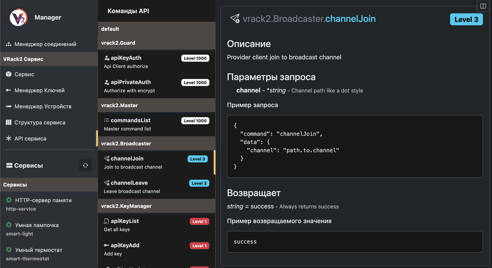
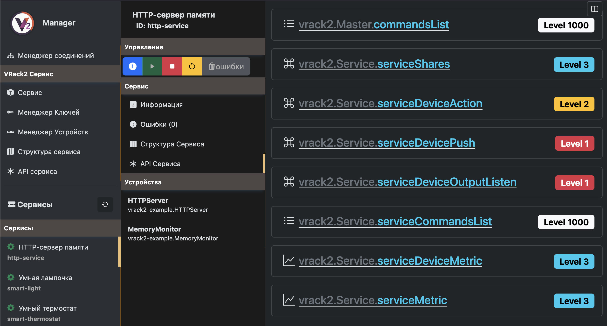
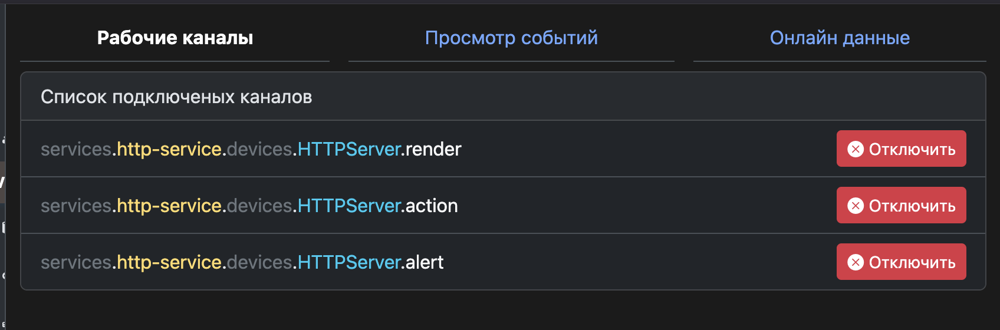

# VRack2 API

Данная документация поможет вам начать взаимодействие с сервером **VRack2** через WebSocket. Полный список команд и их описание доступен в интерфейсе **VRack2 Manager**, так как API динамическое. Здесь приведены только базовые шаги и команды для начала работы.

Рекомендуется использовать [VRack2-Remote](https://github.com/VRack2/vrack2-remote)

Где найти API в **VRack2 Manager**:



Каждый сервис VRack2 запускается так же со своим API, обычно оно не меняется если вы не захотите его расширить. Посмотреть доступные команды для каждого конкретного сервиса можно так:



Нажав в на нужную команду - отобразится документация на нее.

## Рекомендации

- Используйте официальную библиотеку [`vrack2-remote`](https://github.com/VRack2/vrack2-remote) для упрощения работы.

## Подключение

Сервер VRack2 слушает WebSocket-соединения по адресу:  
`ws://<хост>:4044/` (по умолчанию порт 4044).

Все сообщения передаются в формате JSON:

```json
{
  "command": "название_команды",
  "_pkgIndex": 1004,
  "data": { /* параметры */ }
}
```

- `_pkgIndex` — уникальный идентификатор запроса, используется для сопоставления ответа с запросом.

## Аутентификация

### 1. Базовая аутентификация (`apiKeyAuth`)

Уровень доступа: **1000** 

Отправьте ваш API-ключ для идентификации клиента.

**Запрос:**
```json
{
  "command": "apiKeyAuth",
  "data": {
    "key": "ваш_api_ключ"
  }
}
```

**Ответ (пример):**
```json
{
  "cipher": true,
  "verify": "9u49ipjeirhh",
  "serverPub": "-----BEGIN PUBLIC KEY-----\n...\n-----END PUBLIC KEY-----",
  "level": 3,
  "authorize": false
}
```

- Если поле `verify` присутствует — требуется **продолжить аутентификацию через `apiPrivateAuth`**
  (отправить `verify`, зашифрованный в GCM-кадре, см. раздел «Шифрование»).
- `serverPub` — публичный ключ P-256 сервера (PEM), возвращается для асимметричных ключей
  и нужен для вывода ключа канала (ECDH).
- Поле `level` указывает ваш текущий уровень доступа: чем меньше число, тем больше привилегий
  (0 — суперадминистратор).
  - 1 - Администратор
  - 2 - Оператор
  - 3 - Диспетчер
  - 1000 - Гость
- `cipher: true` означает, что дальнейший обмен должен быть зашифрован.

### 2. Приватная аутентификация (`apiPrivateAuth`)

Уровень доступа: **1000**

Если сервер вернул `verify`, зашифруйте его **GCM-кадром** (см. раздел «Шифрование»)
и отправьте поле `frame`.

**Запрос:**
```json
{
  "command": "apiPrivateAuth",
  "data": {
    "frame": "u1f9...=="
  }
}
```

**Ответ (пример):**
```json
{
  "cipher": true,
  "level": 3,
  "authorize": true
}
```

> После успешного выполнения `apiPrivateAuth` **весь дальнейший обмен данными должен быть зашифрован**.

## Шифрование (ECDH P-256 / HKDF / AES-256-GCM)

Ключевым материалом канала служит **ключ 32 байта (`ek`)**, выведенный через HKDF-SHA256:

- **Асимметричные ключи** (созданы через `apiKeyAdd` с `cipher: true`, у ключа есть P-256 публичный ключ):
  `ek = HKDF-SHA256(ikm = ECDH(serverPriv, clientPub), salt = "", info = "vrack2/v2/ek")`.
  Публичный ключ сервера (`serverPub`) приходит в ответе `apiKeyAuth`; приватный ключ клиента
  никогда не передаётся по каналу.
- **Легаси-ключи** (общий секрет `private`):
  `ek = HKDF-SHA256(ikm = private, salt = "vrack2/v2", info = "vrack2/v2/ek")`.

Каждое сообщение зашифрованного канала — **кадр**:

- Шифрование: **AES-256-GCM** (nonce — 12 случайных байт, auth tag — 16 байт).
- Формат кадра: `base64url(nonce ‖ ciphertext ‖ tag)`.
- AAD: `JSON { "c": <clientId>, "s": <seq>, "d": "req" | "res", "v": <verify> }`, где
  - `verify` — challenge из ответа `apiKeyAuth` (привязывает кадр к сессии аутентификации);
  - `seq` — счётчик кадров, отдельный на каждое направление (`req`/`res`), увеличивается на 1;
  - `clientId` — идентификатор клиента, назначенный сервером при подключении.

Неправильный ключ, рассогласование AAD (сессия/счётчик/направление) или повреждённый tag
приводят к ошибке `GUARD_DECIPHER_FAILED`.

Готовый рабочий пример клиента (подключение, аутентификация, зашифрованный вызов команды) —
[vrack2-client.mjs](./vrack2-client.mjs).

## Получение списка команд

### `commandsList`
Уровень доступа: **3**

Возвращает полный список доступных команд с описанием, уровнем доступа и правилами валидации.

**Запрос:**
```json
{
  "command": "commandsList",
  "data": {}
}
```

**Ответ (фрагмент):**
```json
[
  {
    "command": "channelJoin",
    "description": "Provider client join to broadcast channel",
    "level": 3,
    "rules": [],
    "owner": "Broadcaster",
    "short": "Join channel",
    "icon": "share",
    "return": {}
  }
]
```

## Работа с каналами (Pub/Sub)

### Подписка на канал (`channelJoin`)
Уровень доступа: **3**

Подписывает клиента на широковещательный канал по точечному пути.

**Запрос:**
```json
{
  "command": "channelJoin",
  "data": {
    "channel": "path.to.channel"
  }
}
```

**Ответ:**
```json
"success"
```

На данный момент доступны каналы для подключения к событиям и данным всех устройств всех сервисов. Шаблон таких каналов выглядит так

    services.{service-id}.devices.{DeviceID}.{channel}

Пример пути: 

    services.http-service.devices.HTTPServer.render

Вы всегда можете воспользоваться VRack2 Manager для получения пути. Выбрав нужный вам сервис и устройство - подключитесь к нужным вам каналам. Вверху справа будет кнопка консоли, нажав на которую можно будет увидеть пути текущих подключенных каналов:



Есть еще сервисные каналы, с помощью которых можно получать обновления статусов самих сервисов. Это необходимо для реагирование в интерфейсе при отключении/включении сервиса.

Шаблон выглядит так: 

    manager.service.{service-id}.update

Пример пути:

    manager.service.HTTPServer.update

После подписки вам будут приходить сообщения типа:

```json
{ 
   "command":"broadcast",
   "channel":"manager.service.smart-light.update",
   "data":{
        "id":"smart-light",
        "errors":0,
        "run":false,
        "deleted":false,
        "filePath":"devices/vrack2-example/services/smart-light.json",
        "metaPath":"devices/vrack2-example/services/smart-light.meta.json",
        "configPath":"devices/vrack2-example/services/smart-light.conf.json",
        "processPath":"devices/vrack2-example/services/smart-light.process.json",
        "autoReload":false,
        "startedAt":1761064162223},
        "target":"manager.service",
        "providerId":1,
        "clientId":3
    }
```